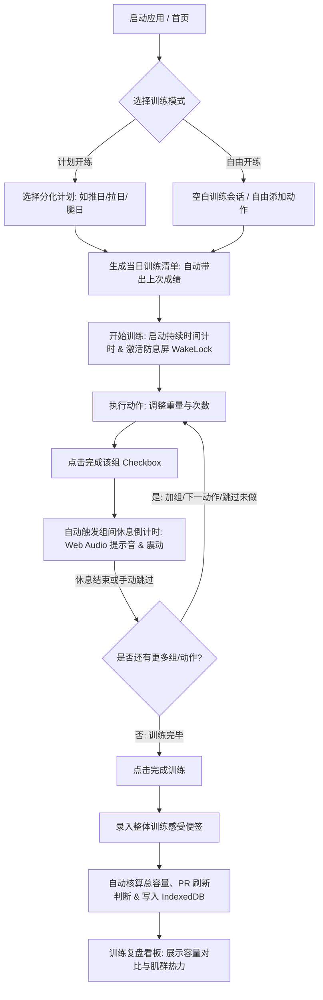

# 个人健身与健康管理系统 (Fitness Tracker) - 综合设计与技术规范 (Specification)

> **版本**：v1.0.0  
> **状态**：设计完成 / 待评审  
> **定位**：离线优先、单手机房友好、iPad 深度适配的个人健身与健康管理 PWA 应用。

---

## 目录
1. [产品定位与核心价值](#1-产品定位与核心价值)
2. [技术选型与架构演进方案 (Approaches)](#2-技术选型与架构演进方案-approaches)
3. [端到端用户使用流程 (User Journeys)](#3-端到端用户使用流程-user-journeys)
4. [5 大核心模块与界面交互规范 (UI/UX Specification)](#4-5-大核心模块与界面交互规范-uiux-specification)
5. [离线数据模型与 TypeScript 实体定义 (Data Models)](#5-离线数据模型与-typescript-实体定义-data-models)
6. [预置动作库规范 (30+ 核心动作清单)](#6-预置动作库规范-30-核心动作清单)
7. [核心计算算法与业务逻辑 (Algorithms & Logic)](#7-核心计算算法与业务逻辑-algorithms--logic)
8. [PWA、防息屏与数据导入导出方案](#8-pwa防息屏与数据导入导出方案)

---

## 1. 产品定位与核心价值

### 1.1 背景与痛点
健身房力量训练与日常健康打卡具有鲜明的场景特性：
1. **网络恶劣**：很多健身房位于商场地下一层或信号屏蔽严重区域，传统云端 App 常因网络阻塞导致卡顿甚至组数丢失。
2. **操作窗口短且手忙脚乱**：大重量间歇心率极高、手汗多，传统键盘输入或微小输入框体验极差。
3. **器械配重与单位混杂**：同一健身房内，自由重量（哑铃）通常为英磅（lb），大型力量器械（固定器械、腿举机）多为公斤（kg），传统软件强制单一单位导致频繁人工换算。
4. **数据归属与隐私**：健身打卡与身材体征数据属于极具隐私的个人健康数据，用户期望数据完全由自己掌控。

### 1.2 核心价值主张
* **零延迟离线优先**：基于浏览器原生 IndexedDB (Dexie.js)，秒开、秒记录，100% 离线可用。
* **单手大触控交互**：针对 iPhone 单手大拇指下半区设计大按键与快速步进器（±2.5kg / ±5lb）。
* **单位独立记忆**：按动作独立记忆首选单位（kg/lb），自由切换无损存储。
* **深度适配多端设备**：iPhone 采用沉浸式 TabBar，iPad 采用横竖屏 Master-Detail 分栏视图。
* **纯结构化计划流**：计划态（预设模板）与完成态（实际执行）解耦，支持自由划掉跳过、加组与随手感悟便签。

---

## 2. 技术选型与架构演进方案 (Approaches)

在架构设计阶段，团队评估了以下两条技术演进路线：

### 方案 A：离线优先 PWA 纯前端方案（已采纳）
* **核心栈**：`React 19` + `TypeScript` + `Vite` + `Tailwind CSS` + `Dexie.js` + `Recharts` + `Lucide React`
* **权衡与取舍**：
  * **优势**：离线可用，在健身房无信号环境下体验无懈可击；零服务器维护成本与隐私风险；配合 iOS Safari PWA 可实现无地址栏的原生应用体验。
  * **取舍**：多设备同步初期依赖标准的 JSON 导出 / 导入快照备份。
* **采纳原因**：深度契合单人健身记录场景下“极致流畅、离线优先”的第一诉求。

### 方案 B：全栈服务端同构方案（Next.js + 关系型数据库）
* **核心栈**：`Next.js (App Router)` + `Prisma/PostgreSQL` (或 Supabase)
* **权衡与取舍**：
  * **优势**：天然支持多设备（手机、平板、电脑）实时自动同步。
  * **劣势**：弱网/断网环境下需编写复杂的本地缓存与双向冲突合并逻辑，且需要维护后端云服务器。
* **结论**：增加不必要的运维成本与网络延迟，故舍弃。

---

## 3. 端到端用户使用流程 (User Journeys)



### 详细步骤说明：
1. **入场开练**：用户到达健身房，打开 PWA。在「今日训练」点击“按计划开练”（如周一腿日）。系统从预设模版实例化出今日待办清单，每个动作下方灰色淡色字体显示“上周成绩：35lb × 12次”。屏幕常亮机制开启。
2. **组数记录**：
   - 第一组做完，用户在输入框确认或点击快速步进按钮（如 `+5lb`）调整重量，点击绿色勾选。
   - 系统立刻弹出悬浮倒计时（默认 90s），屏幕保持常亮。用户可在此期间放下手机喝水调整。
3. **休息结束提醒**：倒计时归零，手机发出清脆的轻提示音并配合设备触觉震动，提醒进行下一组。
4. **动态调整**：遇到器械被占或体力不足，用户轻按动作右上角可“替换动作”或将预定组标记为“（跳过未做）”。
5. **结课保存**：完成训练后，系统汇总“本次总容量：8,450 kg”、“新突破 PR 动作：哑铃卧推 50lb”，生成本次训练总结并即时同步到日历与肌群分析。

---

## 4. 5 大核心模块与界面交互规范 (UI/UX Specification)

### 4.1 全局视口与设备响应式规范
* **iPhone (375px - 430px)**：
  - 采用固定底部 TabBar（高 64px + `env(safe-area-inset-bottom)`），确保大拇指触手可及。
  - 核心操作按钮高度统一 ≥ 48px，数字输入支持专用大字号微调面板。
* **iPad (768px - 1366px，横屏 / 竖屏)**：
  - 采用 **Master-Detail（主从分栏）** 布局：
    - 左侧栏（宽 360px）：当前训练动作列表、完成进度环、总时长。
    - 右侧主区：当前动作的超大记分组数表、上次成绩折线、动作标准姿态图解与要领提醒、大屏组间休息倒计时。

### 4.2 模块 1：今日训练 (Active Workout)
* **顶部状态栏**：训练进行中常驻（总耗时时钟、总负荷容量累加、防息屏状态指示器）。
* **动作卡片组 (Exercise Cards)**：
  - 动作名称 + 主肌群徽章 + 默认单位切换按钮（`kg` / `lb`）。
  - 组记录表格列定义：
    1. 组号（1, 2, 3... 支持标记 W 热身组、D 递减组、F 力竭组）。
    2. 上次成绩（参考列，例如 `40lb × 12`）。
    3. 重量输入框（大按键步进：`-5` `-2.5` `+2.5` `+5`）。
    4. 次数输入框（步进：`-1` `+1`）。
    5. 完成打勾（点击后触发计时，并变为亮绿色）。
    6. 更多操作（删除本组、标记跳过未做）。
  - 动作卡片底部：`+ 添加一组`、`动作便签随手记（如：变轻松了呢！）`。
* **组间休息计时浮层 (Floating Rest Timer)**：
  - 悬浮在底部安全区上方，支持 `+30s`、`-30s`、`跳过`。支持预设 60s/90s/120s/180s。

### 4.3 模块 2：计划排期与分化 (Routines & Schedules)
* **分化训练方案管理**：
  - 预设经典分化模板（推拉腿 PPL、上下肢 Upper/Lower、胸背/腿/肩臂经典三分化、全身综合）。
  - 支持用户新建周期化计划，自由编排每周 7 天的训练日（如：周一推、周二拉、周三休息、周四腿...）。
* **计划日历 (Workout Calendar)**：
  - 月视图与周视图切换，已完成训练日显示高亮绿色实心圆，点击可回溯查看过往日志详情。

### 4.4 模块 3：肌群分析与历史 (Analytics & Muscles)
* **人体肌群热力与疲劳度模拟**：
  - 人体正面/背面矢量解剖图：根据最近 48~72 小时内的训练容量，动态以“疲劳（红色）- 恢复中（黄色）- 完全恢复（绿色）”区分肌群状态。
* **容量与 1RM 渐进超负荷趋势图 (Recharts)**：
  - 支持按动作筛选（如“哑铃卧推”），绘制近 3 个月估算 1RM 与总训练容量折线图。
  - 显示历史最好成绩榜（PR 荣誉墙）。

### 4.5 模块 4：动作指导百科 (Exercise Library)
* **分类与过滤引擎**：
  - 按肌群过滤（胸、背、腿、肩、肱二头、肱三头、核心、全身）。
  - 按器械过滤（哑铃、杠铃、器械、绳索、自重/弹力带）。
* **动作详情面板**：
  - 动作基本信息：标准中文名、英文名、主要发力肌、协同发力肌、器械类型。
  - 标准示范：SVG/轻量动图演示、分步发力要领。
  - 避坑警示：常见代偿错误（如“避免耸肩借力”、“手腕保持中立”）。
  - 个人配置：该动作默认采用的重量单位（kg / lb）。

### 4.6 模块 5：个人体征与数据备份 (Settings & Metrics)
* **身体维度与体重日志**：
  - 录入日期、体重 (kg)、体脂率 (%)、胸围、左右臂围、腰围、臀围、大腿围。
  - 身体关键指标走势折线图。
* **数据安全与备份中心**：
  - 一键导出 JSON（包含所有动作、计划、历史训练日志与身体数据）。
  - 一键导入恢复 JSON（具备数据校验与版本合并机制）。
  - 本地快照重置/清空测试数据。

---

## 5. 离线数据模型与 TypeScript 实体定义 (Data Models)

```typescript
// ==================== 1. 基础枚举与公用类型 ====================
export type MuscleGroup = 
  | 'chest'      // 胸部
  | 'back'       // 背部
  | 'legs'       // 腿部 (股四头/股二头/小腿)
  | 'shoulders'  // 肩部 (前束/中束/后束)
  | 'arms'       // 手臂 (二头/三头)
  | 'core'       // 核心/腹部
  | 'cardio'     // 有氧/全身
  | 'other';

export type EquipmentType = 
  | 'barbell'    // 杠铃
  | 'dumbbell'   // 哑铃
  | 'machine'    // 固定器械
  | 'cable'      // 绳索滑轮
  | 'bodyweight' // 自重/无负重
  | 'band'       // 弹力带
  | 'other';

export type WeightUnit = 'kg' | 'lb';

export type SetType = 'warmup' | 'normal' | 'drop' | 'failure';

// ==================== 2. 动作字典表 (Exercise) ====================
export interface Exercise {
  id: string;                     // 唯一标识 (如 'ex_db_bench_press')
  name: string;                   // 动作名称 (如 '哑铃卧推')
  nameEn?: string;                // 英文名称
  primaryMuscle: MuscleGroup;     // 主要目标肌群
  secondaryMuscles?: MuscleGroup[]; // 辅助肌群
  equipment: EquipmentType;       // 器械类型
  defaultUnit: WeightUnit;        // 默认单位记忆 ('kg' | 'lb')
  isCustom: boolean;              // 是否为用户自定义动作
  instructions: string[];         // 动作要领步骤
  tips?: string[];                // 常见易错警示
  mediaPlaceholder?: string;      // 演示图或矢量动图路径
  createdAt: number;
}

// ==================== 3. 训练计划与模板 (Routine) ====================
export interface RoutineExercise {
  exerciseId: string;
  targetSets: number;             // 预设目标组数 (如 4)
  targetReps: number;             // 预设目标次数 (如 12)
  targetUnit: WeightUnit;
  restSeconds: number;            // 推荐休息时长 (如 90)
  notes?: string;                 // 备注要求
}

export interface Routine {
  id: string;
  name: string;                   // 计划名称 (如 '推拉腿 - 腿日')
  description?: string;
  splitType: 'PPL' | 'UpperLower' | 'Split4' | 'FullBody' | 'Custom';
  dayOfWeek?: number;             // 推荐周期：0 (周日) ~ 6 (周六)
  exercises: RoutineExercise[];
  isBuiltin: boolean;
  createdAt: number;
}

// ==================== 4. 训练日志与组明细 (Workout & Sets) ====================
export interface WorkoutSet {
  id: string;
  sessionId: string;              // 所属训练会话 ID
  exerciseId: string;
  setOrder: number;               // 第几组 (1, 2, 3...)
  setType: SetType;               // 组类型
  weight: number;                 // 重量 (0 表示自重/空)
  unit: WeightUnit;               // 本组单位 ('kg' | 'lb')
  reps: number;                   // 完成次数
  rpe?: number;                   // 主观疲劳度 (1-10)
  isCompleted: boolean;           // 是否打勾完成
  isSkipped?: boolean;            // 是否跳过未做
  isPR?: boolean;                 // 是否打破个人历史最好成绩
  completedAt?: number;
}

export interface WorkoutSession {
  id: string;
  name: string;                   // 会话名称 (如 '周一腿日力量训练')
  routineId?: string;             // 关联的计划模板 ID (可选)
  startTime: number;              // 开始时间戳
  endTime?: number;               // 结束时间戳
  durationSeconds: number;        // 总训练时长 (秒)
  totalVolumeKg: number;          // 统一折算为 kg 的训练总容量
  feelingNotes?: string;          // 训练心得与感受 (如 '器械宽距高位下拉变轻松了呢！')
  exerciseOrder: string[];        // 当天完成的动作 ID 列表
  isFinished: boolean;            // 是否已结课完成
  createdAt: number;
}

// ==================== 5. 身体体征数据 (BodyMetric) ====================
export interface BodyMetric {
  id: string;
  date: string;                   // 日期格式 'YYYY-MM-DD'
  weightKg?: number;              // 体重 (kg)
  bodyFatRate?: number;           // 体脂率 (%)
  muscleMassKg?: number;          // 骨骼肌 (kg)
  chestCircumferenceCm?: number;  // 胸围 (cm)
  waistCircumferenceCm?: number;  // 腰围 (cm)
  hipCircumferenceCm?: number;    // 臀围 (cm)
  leftArmCm?: number;             // 左大臂围 (cm)
  rightArmCm?: number;            // 右大臂围 (cm)
  leftThighCm?: number;           // 左大腿围 (cm)
  rightThighCm?: number;          // 右大腿围 (cm)
  notes?: string;
  createdAt: number;
}
```

### Dexie.js Schema 配置
```typescript
import Dexie, { Table } from 'dexie';

export class FitnessDatabase extends Dexie {
  exercises!: Table<Exercise, string>;
  routines!: Table<Routine, string>;
  workoutSessions!: Table<WorkoutSession, string>;
  workoutSets!: Table<WorkoutSet, string>;
  bodyMetrics!: Table<BodyMetric, string>;

  constructor() {
    super('FitnessTrackerDB');
    this.version(1).stores({
      exercises: 'id, name, primaryMuscle, equipment, isCustom',
      routines: 'id, name, splitType, dayOfWeek, isBuiltin',
      workoutSessions: 'id, routineId, startTime, isFinished',
      workoutSets: 'id, sessionId, exerciseId, isCompleted, isPR',
      bodyMetrics: 'id, date'
    });
  }
}

export const db = new FitnessDatabase();
```

---

## 6. 预置动作库规范 (30+ 核心动作清单)

系统初始启动时自动初始化如下 32 个黄金经典训练动作，满足常见分化需求：

| 编号 | 动作名称 | 主肌群 | 辅助肌群 | 推荐器械 | 默认单位 | 核心要领简要 |
|:---:|:---|:---:|:---:|:---:|:---:|:---|
| 01 | 哑铃卧推 | 胸部 | 三头/肩前 | 哑铃 | lb | 沉肩锁背，手肘内夹 45-60 度，顶峰推起不锁死 |
| 02 | 杠铃卧推 | 胸部 | 三头/肩前 | 杠铃 | kg | 五点支撑，杠铃下落至乳头连线上方，核心收紧 |
| 03 | 上斜哑铃卧推 | 胸部 (上胸) | 三头/肩前 | 哑铃 | lb | 卧推椅 30 度角，直击上胸，缓慢下落充分拉伸 |
| 04 | 哑铃飞鸟 | 胸部 | 肩前束 | 哑铃 | lb | 微屈手臂成抱树姿势，胸肌拉伸感明显，切忌超伸 |
| 05 | 器械推胸 | 胸部 | 肱三头肌 | 固定器械 | kg | 调整握把高度平齐中胸，专注胸大肌发力推挤 |
| 06 | 器械夹胸 | 胸部 (中缝) | 前三角肌 | 固定器械 | kg | 肘部微曲保持固定角度，顶峰挤压胸肌 1-2 秒 |
| 07 | 杠铃深蹲 | 腿部 (股四/臀) | 核心/腘绳 | 杠铃 | kg | 脊柱中立，髋膝协同折叠，大腿至少低于平行线 |
| 08 | 哑铃深蹲 | 腿部 (股四/臀) | 核心 | 哑铃 | lb | 双手持哑铃或高脚杯抱持，膝盖朝向脚尖方向 |
| 09 | 罗马尼亚硬拉 (RDL) | 腿部 (腘绳/臀) | 下背/竖脊 | 哑铃/杠铃 | lb | 微屈膝屈髋后推，重心在脚跟，感受腘绳肌强烈张力 |
| 10 | 哑铃箭步蹲 | 腿部 (臀/单腿) | 核心平衡 | 哑铃 | lb | 身体躯干微微前倾激活臀部，后膝自然下沉微离地 |
| 11 | 宽距器械蹬腿机 | 腿部 (臀/内收) | 股四头肌 | 固定器械 | kg | 脚踩高位宽距，膝盖不内扣，底部腰背紧贴靠背 |
| 12 | 器械腿屈伸 | 腿部 (股四头) | 无 | 固定器械 | kg | 锁骨靠实靠背，双腿顶峰收缩挺直 1 秒，缓慢下放 |
| 13 | 俯卧器械腿弯举 | 腿部 (腘绳肌) | 小腿 | 固定器械 | kg | 骨盆紧贴垫面不借力拱起，脚踝向臀部勾起收缩 |
| 14 | 窄距深蹲跳 | 腿部 (爆发力) | 全身核心 | 自重/空 | kg | 徒手空重下蹲至半蹲，爆发向上跃起，缓冲轻盈落地 |
| 15 | 引体向上 | 背部 (背阔肌) | 肱二头肌 | 自重 | kg | 沉肩下压带动手肘向下向后拉，下巴过杠或胸触杠 |
| 16 | 弹力带辅助引体向上 | 背部 (背阔肌) | 肱二头肌 | 弹力带 | kg | 弹力带套于膝盖或脚掌提供上托助力，保持背部发力 |
| 17 | 器械高位下拉 | 背部 (背阔肌) | 肱二头肌 | 固定器械 | kg | 躯干微微后倾 10 度，手肘垂直向下拉向锁骨处 |
| 18 | 器械坐姿划船 | 背部 (中背/菱形)| 肱二头/后肩 | 绳索/器械 | lb | 挺胸沉肩，双肘贴近肋骨向后拉，顶峰夹紧背胛骨 |
| 19 | 哑铃俯身划船 | 背部 (背阔/中背)| 核心稳定 | 哑铃 | lb | 俯身屈髋背部平直，哑铃沿弧线拉向小腹侧方 |
| 20 | 器械俯身直臂下压 | 背部 (背阔下侧)| 三头长头 | 绳索滑轮 | lb | 手肘微屈固定锁定，双手下压至大腿前侧收缩背阔 |
| 21 | 绳索面拉 (Face Pull) | 肩部 (后束/外旋)| 上背/斜方 | 绳索滑轮 | lb | 绳索高度平齐眼睛，向面部拉开双拳，拇指朝后 |
| 22 | 哑铃推肩 (坐姿) | 肩部 (前束/中束)| 肱三头肌 | 哑铃 | lb | 靠背微倾 80 度，推起至头顶正上方，手肘不锁死 |
| 23 | 哑铃侧平举 | 肩部 (中束) | 斜方肌 | 哑铃 | lb | 上身微前倾，手臂如倒水般向侧上方扬起至平齐 |
| 24 | 俯身哑铃飞鸟 | 肩部 (后束) | 菱形肌 | 哑铃 | lb | 俯身贴近水平，手臂向两侧展开，意念专注于三角肌后束 |
| 25 | 杠铃推举 (站姿) | 肩部 (全肩) | 核心/三头 | 杠铃 | kg | 站立核心绷紧，头部后让杠铃直线上推后头部前探复位 |
| 26 | 哑铃交替弯举 | 手臂 (肱二头肌) | 前臂 | 哑铃 | lb | 动作过程伴随前臂外旋，大臂紧贴身体两侧不上抬 |
| 27 | 绳索下压 | 手臂 (肱三头肌) | 无 | 绳索滑轮 | lb | 大臂垂直地面锁定，双臂伸直向下压紧三头肌 |
| 28 | 仰卧杠铃臂屈伸 | 手臂 (肱三头肌) | 前臂 | 杠铃/曲杠 | kg | 大臂垂直微向后倾斜，下落至头顶上方充分拉伸长头 |
| 29 | 平板支撑 (Plank) | 核心 (腹横肌) | 全身稳定 | 自重 | kg | 身体呈一条直线，腹部深层紧绷，避免骨盆塌陷 |
| 30 | 悬垂举腿 | 核心 (腹直肌下部)| 屈髋肌群 | 自重/单杠 | kg | 骨盆主动向上卷起，不仅是抬腿，避免晃动借力 |
| 31 | 健腹轮推拉 | 核心 (全腹直肌) | 肩/背阔 | 自重/器材 | kg | 保持微猫背卷腹姿势，缓慢向前滚出，靠腹肌力量拉回 |
| 32 | 跑步机慢跑/爬坡 | 有氧/心肺 | 腿部肌肉 | 器械 | kg | 维持目标燃脂心率区间，坡度 4~8% 保护膝关节 |

---

## 7. 核心计算算法与业务逻辑 (Algorithms & Logic)

### 7.1 单位换算逻辑
* 基准转换公式：
  $$1 \text{ lb} = 0.45359237 \text{ kg}$$
  $$1 \text{ kg} \approx 2.20462262 \text{ lb}$$
* 存储规范：
  - 用户实际录入的数值与原始单位存储在 `WorkoutSet.weight` 与 `WorkoutSet.unit` 中。
  - 会话总容量统计时，统一转换为标准公斤数进行累加：
    $$\text{Volume (kg)} = \sum (\text{weight} \times \text{reps} \times (\text{unit} = \text{'lb'} ? 0.453592 : 1))$$

### 7.2 估算 1RM (最大单次重量) 算法
采用业界验证最为精准的 **Epley 公式** 与 **Brzycki 公式** 综合加权：
* 当完成次数 $\text{reps} = 1$ 时：$1\text{RM} = \text{weight}$
* 当完成次数 $2 \le \text{reps} \le 12$ 时（Epley 公式）：
  $$1\text{RM} = \text{weight} \times \left(1 + \frac{\text{reps}}{30}\right)$$
* 当完成次数 $> 12$ 时，1RM 预测误差增大，降权处理仅作参考。

### 7.3 渐进超负荷与 PR 判定逻辑
在用户点击打勾完成某一训练组时，触发自动校验函数 `checkProgressiveOverload(exerciseId, weight, reps, unit)`：
1. 从 Dexie 查询该动作历史所有完成组的最大估算 1RM。
2. 若当前组的估算 1RM 超过历史纪录，则将该组标记为 `isPR = true`。
3. 界面触发彩带微动效与金色“新纪录 PR”徽章展示。

---

## 8. PWA、防息屏与数据导入导出方案

### 8.1 屏幕防息屏 (Screen Wake Lock API)
在力量训练会话期间，调用浏览器原生 API 防止 iOS/Android 屏幕自动变暗息屏：
```typescript
let wakeLockSentinel: WakeLockSentinel | null = null;

export async function requestKeepScreenOn(): Promise<void> {
  if ('wakeLock' in navigator) {
    try {
      wakeLockSentinel = await navigator.wakeLock.request('screen');
    } catch (err) {
      console.warn('Wake Lock request failed:', err);
    }
  }
}

export function releaseKeepScreenOn(): void {
  if (wakeLockSentinel) {
    wakeLockSentinel.release();
    wakeLockSentinel = null;
  }
}
```

### 8.2 Web Audio 组间休息提示音
无需加载外部 mp3 静态大文件，采用原生 Web Audio API 合成轻量清脆双音节哔声（880Hz / 1760Hz）：
```typescript
export function playRestTimerBeep(): void {
  const ctx = new (window.AudioContext || (window as any).webkitAudioContext)();
  const osc = ctx.createOscillator();
  const gain = ctx.createGain();
  osc.type = 'sine';
  osc.frequency.setValueAtTime(880, ctx.currentTime);
  osc.frequency.exponentialRampToValueAtTime(1760, ctx.currentTime + 0.15);
  gain.gain.setValueAtTime(0.3, ctx.currentTime);
  gain.gain.exponentialRampToValueAtTime(0.01, ctx.currentTime + 0.25);
  osc.connect(gain);
  gain.connect(ctx.destination);
  osc.start();
  osc.stop(ctx.currentTime + 0.25);
  if ('vibrate' in navigator) {
    navigator.vibrate([200, 100, 200]);
  }
}
```

### 8.3 数据导入与导出规范 (JSON Snapshot)
* 导出文件命名约定：`fitness-backup-YYYY-MM-DD-HHmm.json`
* 包含字段：
  ```json
  {
    "version": 1,
    "exportedAt": 1729938000000,
    "appName": "FitnessTracker",
    "data": {
      "exercises": [...],
      "routines": [...],
      "workoutSessions": [...],
      "workoutSets": [...],
      "bodyMetrics": [...]
    }
  }
  ```
* 导入保障：导入前进行 JSON Schema 格式合法性校验，支持“覆盖合并”与“全量替换”两种模式，保障历史数据不丢失。
