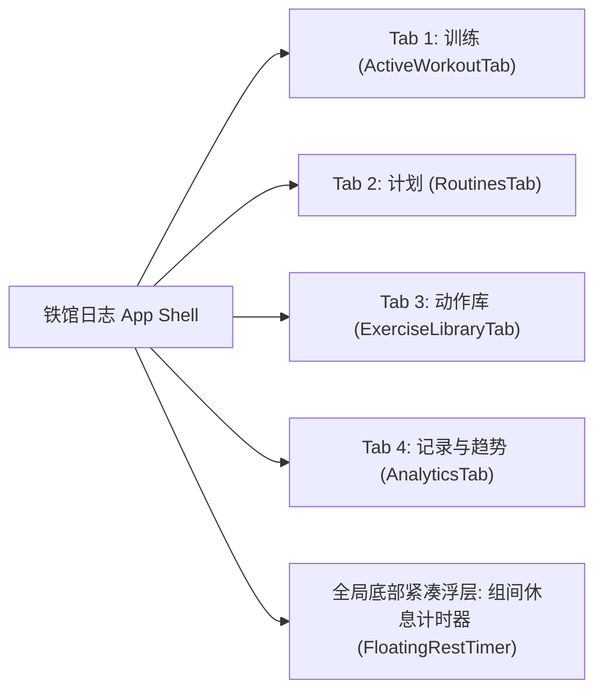

# 个人健身与健康管理系统 (Fitness Tracker) - 极简版综合设计与技术规范 (Specification v2.0)

> **版本**：v2.0.0  
> **状态**：待评审 (Brainstorming 共识版)  
> **定位**：极致简洁、离线优先、单手大触控友好、iPad 分栏适配的个人力量训练与健康追踪 PWA。

---

## 目录
1. [设计意图与重构背景 (Intent & Why)](#1-设计意图与重构背景-intent--why)
2. [目标、非目标与反目标 (Goals, Non-Goals & Anti-Goals)](#2-目标非目标与反目标-goals-non-goals--anti-goals)
3. [技术架构与实现方案对比 (Approaches)](#3-技术架构与实现方案对比-approaches)
4. [全局导航与 4-Tab 信息架构](#4-全局导航与-4-tab-信息架构)
5. [四大核心模块交互与功能规范](#5-四大核心模块交互与功能规范)
   - [5.1 Tab 1：训练 (Active Workout)](#51-tab-1训练-active-workout)
   - [5.2 Tab 2：计划 (Routines & Inline Editor)](#52-tab-2计划-routines--inline-editor)
   - [5.3 Tab 3：动作库 (Exercise Library)](#53-tab-3动作库-exercise-library)
   - [5.4 Tab 4：记录与趋势 (History, Trends & Backup)](#54-tab-4记录与趋势-history-trends--backup)
6. [数据模型与 Dexie.js 存储契约](#6-数据模型与-dexiejs-存储契约)
7. [关键业务算法与联动逻辑](#7-关键业务算法与联动逻辑)
8. [Modern Web Guidance 现代 Web 规范落地清单](#8-modern-web-guidance-现代-web-规范落地清单)
9. [留给实现者的工程细节决策 (Left to the Builder)](#9-留给实现者的工程细节决策-left-to-the-builder)

---

## 1. 设计意图与重构背景 (Intent & Why)

在健身房高心率、手汗多、信号弱的真实训练场景下，用户点开手机的核心诉求只有两个：**「看清今天练什么并立刻开练」** 和 **「用最少点击完成每一组的重量/次数打卡」**。

* **v1.0 的痛点**：采用 5-Tab 架构，页面内堆砌了过多顶部统计横幅、复杂的周期排班表、RPE 疲劳度滑块、多维身体围度大表单及多张图表，导致移动端视觉拥挤、操作层级深。
* **v2.0 的核心演进**：对标 Strong / Hevy 等行业标杆，确立 **「清爽 4-Tab + 手风琴原地展开微调 + 渐进超负荷自动带出重量 + 结课反向同步模板」** 的极简工作流，砍掉一切非核心视觉噪音，让每个页面在一屏之内聚焦单一核心任务。

---

## 2. 目标、非目标与反目标 (Goals, Non-Goals & Anti-Goals)

### 2.1 核心目标 (Goals)
1. **清晰的 4-Tab 职责划分**：`训练`（专注当下流汗打卡）、`计划`（模板管理与原地展开微调）、`动作库`（检索动作与要领）、`记录与趋势`（容量/体重趋势图、历史日志与 JSON 备份）。
2. **计划模板原地展开微调 + 一键开练**：支持用户自定义新建计划，点击任意计划卡片即可原地展开，通过 `+/-` 步进器实时微调每个动作的「目标组数 × 目标次数 × 休息秒数」、调整动作顺序、增删动作及绑定推荐星期几，无需跳转多层弹窗或手动点保存。
3. **训练与计划的双向丝滑联动**：
   - **正向启动**：按模板开练时，组数与目标次数来自模板，而**重量自动继承该动作上一次完成的真实重量**（按动作记忆的 `kg/lb` 单位无损转换）。
   - **反向同步**：训练途中若临时增删了动作或组数，点击「完成训练」时自动检测结构差异，提供勾选框一键将最新结构更新回原计划模板。
4. **单手大触控与多端响应式**：按钮触控热区 ≥ 44px；iPhone 采用底部 4-Tab 栏，iPad/桌面端采用顶部导航 + 训练页左右 Master-Detail 分栏。

### 2.2 非目标 (Non-Goals)
1. 不做云端账号体系或多人社交动态，保持 100% 本地 IndexedDB 存储 + JSON 导入导出。
2. 不在计划模板中硬编码固定目标重量（重量由历史成绩动态驱动）。
3. 不做复杂的全身 7 部位围度（胸/腰/臀/左右臂/左右腿）录入表单，体征仅聚焦「体重 (kg) + 体脂率 (% 可选)」。

### 2.3 反目标 / 禁区 (Anti-Goals)
1. **严禁卡片内多层嵌套滚动条与冗余横幅**：任何 Tab 首屏不得出现超过 1 个以上的说明性横幅。
2. **严禁跟练行内堆砌次要控件**：组记录行内不放 RPE 滑块、不放单组备注输入框，确保在 375px 宽度下组号、重量步进器、次数步进器与完成勾选按钮宽敞清晰。
3. **严禁未确认的数据丢失**：删除自定义计划、删除自定义动作、放弃进行中训练、删除历史记录或重置出厂数据，均须经过二次确认。

---

## 3. 技术架构与实现方案对比 (Approaches)

### 采纳方案：方案 1 —— 基于 Dexie `useLiveQuery` 的响应式直写架构 + 原生 HTML/CSS 现代交互
* **机制说明**：
  1. **计划原地微调直写 IndexedDB**：在 `RoutinesTab` 展开某张计划卡片后，用户点击 `+/-` 修改目标组数、次数、休息时长、修改计划名称、绑定星期几或上下移动动作时，直接调用 `db.routines.update(routine.id, ...)`。利用 `dexie-react-hooks` 的 `useLiveQuery` 毫秒级自动更新视图，零草稿态同步成本。
  2. **结课结构差异检测 (Routine Diff Detection)**：在 `ActiveWorkoutTab` 弹出完成训练 `<dialog>` 时，对比本次会话实际执行的动作列表（`exerciseOrder`）及每个动作的组数，与原关联 `Routine.exercises` 是否存在差异（动作增删、顺序变化、或某动作组数变化）。若存在差异，在结算弹窗显示勾选框：`[x] 将本次动作与组数变更同步更新到「{routine.name}」模板`。
  3. **原生 `<dialog>` 与 CSS `calc-size()`**：所有弹窗（选择动作、新建计划、完成训练）均采用 `<dialog closedby="any">`，手风琴展开统一采用 CSS `interpolate-size: allow-keywords` 与 `calc-size(auto, size)`。

### 备选方案（已放弃）：方案 2 —— 本地表单草稿态 (Draft State) + 手动保存事务
* **放弃原因**：在移动端展开卡片微调几项参数后，用户极易直接切换底部 Tab 或直接点击「一键开练」，要求手动点击“保存修改”不仅多一步操作，还容易造成未保存状态丢失。

---

## 4. 全局导航与 4-Tab 信息架构

| Tab 序号 | 名称 | 图标 (`lucide-react`) | 核心职责 |
| :--- | :--- | :--- | :--- |
| **Tab 1** | **训练** | `Dumbbell` | 未开练时展示「今日推荐计划 + 自由训练」；开练后展示实时计时、动作卡片、重量/次数大步进器与完成打勾。 |
| **Tab 2** | **计划** | `Calendar` | 展示所有训练计划模板；支持「+ 新建计划」、点击卡片原地展开微调（组数/次数/休息/排序/星期绑定）及「一键开练」。 |
| **Tab 3** | **动作库** | `BookOpen` | 搜索 + 肌群筛选；切换动作默认单位 (`KG/LB`)；点击卡片展开查看动作步骤与提示；支持新增/删除自定义动作。 |
| **Tab 4** | **记录与趋势** | `Activity` | 顶部 3 项核心汇总指标；「训练容量 / 体重走势」二合一可切换趋势图 + 快速记体重；可折叠历史训练日志；JSON 导入/导出与重置。 |

* **导航栏交互表现**：
  - **iPhone (< 768px)**：底部固定 `grid-cols-4` 导航栏（高 56px + `env(safe-area-inset-bottom)`）；当存在进行中的训练且用户切到其他 Tab 时，「训练」Tab 图标右上角显示绿色呼吸圆点，顶部栏右侧显示「训练中」快捷返回胶囊。
  - **iPad / Desktop (≥ 768px)**：顶部栏右侧内嵌 4 个分段导航按钮，底部不显示移动端 TabBar。

---

## 5. 四大核心模块交互与功能规范

### 5.1 Tab 1：训练 (`ActiveWorkoutTab.tsx`)

#### 状态 A：当前无进行中训练（未开练启动台）
1. **今日推荐计划卡片（置顶高亮）**：
   - **匹配逻辑**：获取当前本地星期几 `new Date().getDay()`（0~6）。优先查找 `routine.dayOfWeek === today` 的计划；若匹配到多个则全部列出，若无匹配则展示排在第一位的计划（并标注「常用推荐」）。
   - **展示内容**：计划名称、星期标签（如「周一推荐」）、包含的动作胶囊列表。
   - **操作按钮**：醒目的绿色主按钮 **「按此计划开练」** + 次要文字按钮 **「去计划页微调 / 全部模板 ->」**（点击切换至 Tab 2 `routines`）。
2. **空白自由训练入口**：
   - 提供独立卡片或通栏次要按钮 **「+ 开始空白自由训练」**（适合临时起意不按固定模板练的场景）。
3. **其他计划快捷列表**：
   - 在今日推荐下方，以简洁的 2 列网格展示其余计划模板卡片，每张卡片均可一键点击 **「开练」**。

#### 状态 B：当前有进行中训练（跟练打勾面板）
1. **顶部紧凑状态栏**：
   - 左侧：当前训练名称（如「推拉腿 - 推日」），下方单行等宽字体展示：`用时 MM:SS · 完成 X/Y 组 · 容量 ZZZ kg`。
   - 右侧 3 个按钮：**「+ 加动作」**、**「完成训练」**（主色）、**「放弃训练（垃圾桶图标，带 confirm 二次确认）」**。
2. **响应式布局（iPhone vs iPad）**：
   - **iPhone (< 768px)**：所有动作卡片自上而下垂直排列。
   - **iPad / 桌面 (≥ 768px)**：采用 `12 列` **Master-Detail 主从分栏**：
     - 左侧栏（`col-span-4`）：当前训练动作目录列表（显示序号、动作名、`已完成组/总组数`），点击切换当前聚焦动作。
     - 右侧栏（`col-span-8`）：当前选中动作的跟练详情卡片。
3. **单个动作跟练卡片结构**：
   - **卡片头部**：
     - 左侧：动作名称 + `主肌群 · 器械` 徽章；次行淡色小字显示**上次成绩参考**（如：`上次: 60kg×10, 60kg×10, 62.5kg×8`；若上次有动作便签则一并同行提示 `📝 座椅 4 档`）。
     - 右侧工具按钮组：
       1. **单位切换按钮 (`KG` / `LB`)**：点击立即切换该动作的 `defaultUnit`，并将当前未完成组的重量按精度（`0.5`）自动换算。
       2. **动作便签开关按钮（`StickyNote` 图标）**：点击展开/收起一行轻量的单动作备注输入框（实时保存在 `currentSession.exerciseNotes[exerciseId]` 中，下次练该动作时自动展示）。
       3. **移除动作按钮（`Trash2` 图标）**：从本次训练中移除该动作及其组数据（若已有完成组则 `confirm` 确认）。
   - **组记录行（Set Row）**：
     - **组类型按钮**：固定宽高 `32×32px` 徽章，普通组显示组序号 `1, 2, 3...`，点击循环切换 `normal (N)` -> `warmup (W 热身)` -> `drop (D 递减)` -> `failure (F 力竭)`；若该组打破历史最高估算 1RM，右侧紧跟金色 `PR` 徽章。
     - **重量步进区**：`[-] (40×40px)` + `数字输入框（带单位下标）` + `[+] (40×40px)`。步进幅度：`kg` 模式下每次 `±2.5kg`，`lb` 模式下每次 `±5lb`（自重动作默认重量为 `0`，仍允许录入负重）。
     - **次数步进区**：`[-] (40×40px)` + `数字输入框（次）` + `[+] (40×40px)`，步进幅度 `±1`。
     - **完成打勾按钮**：点击切换完成态（亮绿色背景），勾选瞬间播放轻快提示音、校验是否破 PR（破 PR 触发轻量彩带），并**自动按该动作预设休息秒数（若来自计划模板则取 `RoutineExercise.restSeconds`，否则默认 `90s`）启动底部休息计时器**。
     - **删除单组按钮**：右侧轻量删除图标。
   - **卡片底部**：通栏虚线按钮 **`+ 加一组`**（新组默认复制上一组的重量、次数与单位）。
4. **完成训练结算弹窗 (`<dialog closedby="any">`)**：
   - 展示本次汇总：总用时、完成组数、总容量 (kg)。
   - **智能模板同步复选框（条件渲染）**：若本次会话关联了 `routineId` 且原计划依然存在，对比发现本次会话的动作列表或各动作组数与原计划不一致时，显示勾选框（默认勾选 `true`）：
     - `☑ 将本次动作与组数变更同步更新回计划模板「{routine.name}」`
     - 若勾选，保存训练时同步更新 `Routine.exercises`（新增动作默认取本次完成的组数、中位/首组次数及 90s 休息时长；原有动作更新 `targetSets` 为本次该动作的总组数）。
   - **整体训练感受输入框**：可选填今日总结备注。

---

### 5.2 Tab 2：计划 (`RoutinesTab.tsx` —— 模板管理与原地展开微调)

1. **顶部标题与新建栏**：
   - 标题：「训练计划模板」，副标题提示：「点击任意计划展开微调动作与组数，或直接一键开练」。
   - 右侧主按钮：**「+ 新建计划」**（点击打开新建计划弹窗或直接在列表顶部创建新计划并自动展开进入编辑态）。
2. **手风琴计划卡片列表 (Accordion Cards)**：
   - **卡片收起头部（常驻可见）**：
     - 左侧（点击可切换展开/收起）：
       - 第一行：**计划名称**（如 `推拉腿 - 推日 (胸/肩/三头)`） + **星期几徽章**（若设置了 `dayOfWeek`，显示如 `周一` 胶囊徽章） + 展开箭头 `ChevronDown`。
       - 第二行：包含的动作数量及名称概览（如 `5 个动作 · 杠铃平板卧推 · 上斜哑铃卧推 · 坐姿哑铃推肩...`）。
     - 右侧（独立操作，不触发展开）：
       - **「一键开练」按钮**：点击立即按该计划生成新的 `WorkoutSession`（若当前已有未完成的训练会话，先弹窗确认「当前有未完成的训练，是否结束/替换并开始新计划？」），并自动跳转至 Tab 1（`workout`）。
   - **卡片展开面板（原地实时微调区，使用 `.expandable-panel` 平滑展开）**：
     - **第一栏：计划基础信息微调**：
       - **计划名称输入框**：支持直接修改计划名称（`onBlur` 或 `onChange` 实时写入 `db.routines.update`）。
       - **推荐训练日选择（星期绑定）**：横向一排轻量胶囊按钮：`不限`、`周一`、`周二`、`周三`、`周四`、`周五`、`周六`、`周日`，点击即切换 `routine.dayOfWeek`。
     - **第二栏：计划内动作明细列表（逐行微调）**：
       - 每一行对应一个 `RoutineExercise`，展示：
         1. **排序与动作名**：左侧提供上下移动箭头（`ArrowUp` / `ArrowDown`）调整动作先后顺序 + 动作名称 + 肌群小字。
         2. **目标组数步进器**：`[-]` `4 组` `[+]`（范围 `1 ~ 15` 组，点击实时更新 `targetSets`）。
         3. **目标次数步进器**：`[-]` `10 次` `[+]`（范围 `1 ~ 50` 次，点击实时更新 `targetReps`）。
         4. **休息时长快捷切换**：点击循环切换或下拉选择 `60s / 90s / 120s / 180s`（实时更新 `restSeconds`）。
         5. **移除动作按钮（`Trash2`）**：将该动作从计划模板中移除。
     - **第三栏：计划底部操作栏**：
       - 左侧：**「+ 添加动作到此计划」**（点击唤起复用动作选择 `<dialog>`，选定动作后追加到当前计划末尾，默认 `4 组 × 10 次 · 90s 休息`）。
       - 右侧：**「复制计划」**（一键克隆副本方便做 A/B 计划微调） + **「删除计划」**（带 `window.confirm` 二次确认，预置计划与自定义计划均支持删除，若删空可通过设置里的恢复出厂重置）。

---

### 5.3 Tab 3：动作库 (`ExerciseLibraryTab.tsx`)

1. **顶部检索与新增区**：
   - 搜索输入框（按中英文名称实时过滤） + **「+ 新增动作」** 按钮。
   - 横向肌群过滤胶囊：`全部肌群`、`胸部`、`背部`、`腿部`、`肩部`、`手臂`、`核心`、`有氧/全身`。
2. **动作卡片网格（2 列响应式）**：
   - 常驻显示：动作名称、`主肌群 · 器械类型`、右侧 **`KG / LB` 默认单位一键切换按钮**（若为自定义动作额外显示删除按钮）。
   - 点击卡片主体原地展开：展示动作标准步骤列表（`instructions`）与常见易错提示（`tips`）。
3. **新增自定义动作弹窗 (`<dialog closedby="any">`)**：
   - 录入项：动作名称（必填）、主肌群、器械类型、默认单位（KG/LB）、动作要领备注（选填）。

---

### 5.4 Tab 4：记录与趋势 (`AnalyticsTab.tsx`)

1. **第一部分：顶部 3 项核心汇总指标卡 (`grid-cols-3`)**：
   - **累计打卡**：已完成训练总场次（次）。
   - **累计总容量**：历史所有完成组折算总吨数（吨，保留 1 位小数）。
   - **最新体重**：最近一次录入的体重（`kg`，若同时录入了体脂率则在副标题小字展示 `体脂 XX%`）。
2. **第二部分：二合一可切换趋势图 + 快速体重记录**：
   - **图表卡片头部**：左侧标题，右侧分段切换胶囊 **`[训练容量 (kg)]` / `[体重变化 (kg)]`**。
     - 当选中「训练容量」时：展示最近 12 场训练的总容量 `AreaChart` 面积折线图。
     - 当选中「体重变化」时：展示最近 15 次体重记录的 `AreaChart` 折线图。
   - **单行快速记录今日体重条**：内嵌在图表下方，包含 `体重 (kg)` 输入框、`体脂 % (选填)` 输入框与 **「记录」** 按钮，提交后立即刷新最新体重与体重走势图。
3. **第三部分：可折叠历史训练日志列表**：
   - 按训练开始时间倒序排列已完成的 `WorkoutSession`。
   - 收起态：训练名称、日期星期、总用时、完成组数、总容量 (kg)、训练心得语录（若有）及删除按钮（带二次确认）。
   - 点击展开后：按动作汇总展示当天完成的每一组 `重量(单位) × 次数` 明细（如 `杠铃卧推: 60kg×10 / 65kg×8 / 65kg×8`）。
4. **第四部分：本地离线数据备份与恢复栏**：
   - 提供 **「导出 JSON」**、**「导入恢复（合并模式）」** 与 **「重置出厂数据（带二次确认）」**。

---

## 6. 数据模型与真实训练日志预置规范 (Seed & Migration Contract)

现有 `src/types/fitness.ts` 与 `src/db/database.ts` 完全满足 v2.0 需求。同时，基于用户提供的 **2026年7月20日 ~ 2026年10月22日 共 29 场真实训练日志**，对预置动作库、默认分化计划与历史日志数据进行全量定制：

### 6.1 真实训练分化计划 (`INITIAL_ROUTINES`)
根据用户最新（9月~10月）稳定执行的训练周期，预置以下 5 套专属计划模板：
1. **周一 · 臀腿综合训练 (`routine_user_legs`, 周一 `dayOfWeek: 1`)**：
   - `哑铃深蹲` (6组×12次, lb) · `哑铃罗马尼亚硬拉` (6组×12次, lb) · `箭步蹲` (6组×12次, lb) · `窄距深蹲跳` (4组×12次, 自重) · `器械腿屈伸` (2组×12次, kg) · `宽距器械蹬腿机` (6组×15次, kg)
2. **周二 · 胸部全维轰炸 (`routine_user_chest`, 周二 `dayOfWeek: 2`)**：
   - `哑铃卧推` (6组×12次, lb) · `哑铃飞鸟` (6组×12次, lb) · `器械推胸` (6组×12次, kg) · `器械夹胸` (6组×12次, kg) · `上斜哑铃卧推` (6组×12次, lb) · `上斜哑铃飞鸟` (6组×12次, lb)
3. **周四 · 背部与后束强化 (`routine_user_back`, 周四 `dayOfWeek: 4`)**：
   - `器械坐姿划船` (6组×12次, lb) · `器械俯身直臂下压` (6组×15次, lb) · `哑铃俯身划船` (6组×12次, lb) · `绳索面拉` (6组×15次, lb) · `器械宽距高位下拉` (6组×12次, kg) · `弹力带辅助引体向上` (4组×12次, 自重)
4. **周五 · 肩部与三头联合 (`routine_user_shoulders_arms`, 周五 `dayOfWeek: 5`)**：
   - `哑铃推举` (6组×12次, lb) · `哑铃颈后臂屈伸` (6组×12次, lb) · `哑铃前平举` (6组×12次, lb) · `绳索直杆下压` (6组×12次, lb) · `俯身哑铃飞鸟` (6组×12次, lb) · `绳索三头下压` (5组×12次, lb) · `凳上臂屈伸` (4组×12次, 自重) · `哑铃俯身臂屈伸` (6组×12次, lb)
5. **备选 · 上斜胸与中缝专项 (`routine_user_incline_chest`, 周六 `dayOfWeek: 6`)**：
   - `上斜哑铃卧推` (6组×12次, lb) · `上斜哑铃飞鸟` (6组×12次, lb) · `器械推胸` (6组×12次, kg) · `器械蝴蝶机夹胸` (6组×12次, kg) · `上斜窄距杠铃卧推` (4组×12次, lb) · `龙门架绳索夹胸` (6组×12次, lb)

### 6.2 29 场真实训练日志全量导入与自动迁移
- 将 `2026-07-20` 至 `2026-10-22` 的全部 29 场训练会话（含精确日期、每组重量/单位/次数、热身组与力竭组标记、未做跳过标记 `isSkipped: true`、以及如 `“器械宽距高位下拉变轻松了呢！”`、`“下次保持，有点勉强”`、`“2 改 25 了 -…-”` 等原汁原味的随手记备注）完整编码入 `src/db/seedData.ts`。
- 在 `ensureDatabaseSeeded()` 中通过数据版本标记（`localStorage.getItem('fitness_seed_v2_real_logs')`）自动检测：若浏览器中仍是旧版 4 条虚拟 Demo 数据，则自动替换为这 29 场真实训练日志与 5 套专属计划模板，无需用户手动点重置即可直接看到全部真实历史数据。

---

## 7. 关键业务算法与联动逻辑

1. **按模板一键开练的重量继承算法**：
   - 遍历 `routine.exercises`，对每个动作查询 `getLastPerformanceForExercise(exerciseId, newSessionId)`。
   - 目标单位取 `exercise.defaultUnit || item.targetUnit || 'kg'`。
   - 对第 `1 .. item.targetSets` 组：若上次有对应第 `i` 组（或最后一组）记录，将其重量通过 `convertWeight(prevSet.weight, prevSet.unit, unit)` 转换为当前单位（四舍五入至 `0.5` 步进）；次数默认取模板设定的 `item.targetReps`（优先遵循用户在模板中微调的目标次数）。若无历史记录，杠铃/哑铃/器械默认给初始引导重量（`20kg` 或 `45lb`），自重动作给 `0`。
2. **训练结课反向同步模板算法 (`hasRoutineDiff` & `syncSessionToRoutine`)**：
   - **差异判定 (`hasRoutineDiff`)**：当 `currentSession.routineId` 指向有效 `Routine` 时，提取当前会话中的 `exerciseOrder` 及每个动作下的组列表（若某动作有已完成组则取已完成组，否则取该动作当前全部组）。只要满足以下任一条件即视为有变更：
     1. 动作 ID 序列与 `routine.exercises.map(e => e.exerciseId)` 长度或顺序不同；
     2. 任意动作在本次会话中的组数与 `routine.exercises[i].targetSets` 不同。
   - **同步写入 (`syncSessionToRoutine`)**：根据当前会话的 `exerciseOrder` 生成新的 `RoutineExercise[]`：
     - 若动作原本就在该 `Routine` 中：保留原有的 `restSeconds` 与 `targetUnit`，将 `targetSets` 更新为本次组数，`targetReps` 更新为本次该动作第一组（或已完成组）的 `reps`。
     - 若动作是本次训练中途新加的：`targetSets` 取本次组数，`targetReps` 取首组次数，`restSeconds` 默认 `90`，`targetUnit` 取动作当前 `defaultUnit`。

---

## 8. Modern Web Guidance 现代 Web 规范落地清单

1. **`light-dismiss-a-dialog`**：所有模态框（动作选择器、新建计划、完成训练确认、新增自定义动作）统一使用原生 `<dialog closedby="any">` 并通过 `.showModal()` 打开，同时挂载 Safari 兼容的坐标边界点击关闭监听器。
2. **`animate-to-intrinsic-sizes`**：在 `:root` 启用 `interpolate-size: allow-keywords`，所有可折叠区域（计划卡片微调区、动作库要领、历史训练详情）统一使用 `.expandable-panel`（`block-size: auto; block-size: calc-size(auto, size);`），同步 `aria-expanded` 与 `hidden` 属性，并在 `@media (prefers-reduced-motion: reduce)` 下禁用过渡。
3. **`dark-mode`**：在 `index.html` 声明 `<meta name="color-scheme" content="dark" />`，在 `:root` 设置 `color-scheme: dark`、`accent-color: #10b981` 及 `scrollbar-width: thin; scrollbar-color: #334155 #090d16;`。
4. **`improve-text-layout-and-legibility`**：仅对标题元素 `h1~h4` 应用 `text-wrap: balance`，对段落与列表项 `p, li` 应用 `text-wrap: pretty`。
5. **`responsive-design`**：全局容器使用动态视口单位 `min-h-dvh`，配合 iOS 安全区 `env(safe-area-inset-top/bottom)`。

---

## 9. 留给实现者的工程细节决策 (Left to the Builder)

- **新建计划的交互形式**：点击「+ 新建计划」时，弹出一个极简 `<dialog>` 让用户输入计划名称、选择推荐星期几，确认后立即创建并自动在列表中展开该计划卡片，并自动弹出动作选择器方便添加动作。
- **训练中点击「一键开练」的冲突保护**：如果当前已有未完成的 `WorkoutSession`，在「计划」页点击另一个模板的「一键开练」时，弹出原生 `window.confirm('当前有正在进行的训练，是否放弃当前训练并开始新计划？')`，确认后清理旧未完成会话并启动新计划。
- **动作专属休息秒数传递**：在 `ActiveWorkoutTab` 中勾选完成某组时，若当前训练关联了 `Routine` 且该动作在模板中配置了 `restSeconds`（如 `60s` 或 `120s`），则优先使用该动作配置的 `restSeconds` 启动底部倒计时，否则默认使用 `90s`。
